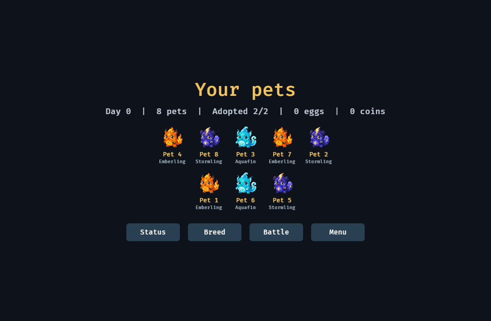
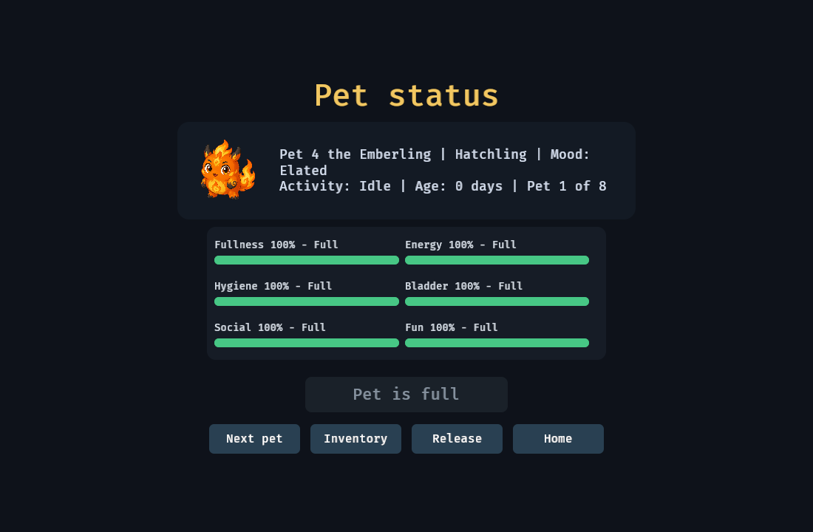
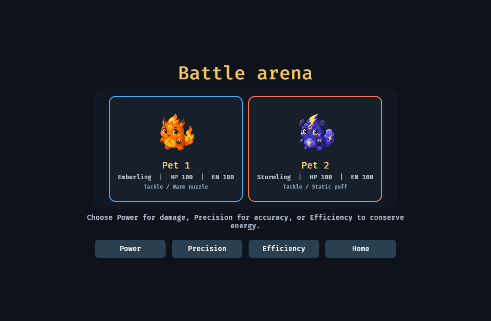

# Rustagotchi

A deterministic desktop virtual-pet game with care, genetics, breeding,
turn-based combat, offline progression, and recoverable SQLite saves. Built in
Rust with Bevy.

> **Status: playable desktop vertical slice.** The deterministic game
> core includes care, breeding, genetics, combat, offline progression and
> recoverable SQLite saves. The first Bevy desktop slice now boots a new or
> existing world, applies offline and live progression, creates and feeds
> founder pets, displays care status and inventory, breeds and hatches eggs,
> uses explicit pet and pair selection for care, breeding, and battle, resolves
> deterministic battles with rewards, and saves through the application command
> boundary. Existing save slots can be inspected/switched, and critical offline
> or live pet events produce best-effort native notifications. The UI supports
> responsive layouts, accessible keyboard controls, global command feedback,
> event-driven visual/audio cues, mute, and reduced-motion controls. See
> [docs/implementation-plan.md](docs/implementation-plan.md) for what lands when.

The real presentation command path also has headless SQLite-backed smoke tests
covering onboarding, care, breeding, incubation, hatching, battle, save/reload,
catch-up, and the eight-pet headless CPU frame budget.

A deterministic native render verifier also opens the real 1100×720 desktop
window, captures the eight-pet Home screen, validates all three species sprites,
and saves a PNG artifact. CI runs it on Windows and Linux.

For a complete setup and gameplay walkthrough, see [guide.md](guide.md).

## In-game screens

| Home | Pet Status |
|---|---|
|  |  |

### Battle arena



## Getting started

Prerequisites:

- Git and [rustup](https://rustup.rs/).
- Windows: Visual Studio Build Tools with the Desktop development with C++ workload.
- Linux: a C compiler plus the development libraries required by Bevy/winit.
- macOS: Xcode Command Line Tools.

Clone and enter the repository:

```bash
git clone https://github.com/rustagotchi/rustagotchi.git
cd rustagotchi
```

Install the pinned Rust 1.97.1 toolchain and optional project quality tools:

```bash
# Linux/macOS
./scripts/setup.sh

# Windows PowerShell
.\scripts\setup.ps1
```

For playing only, the setup script is optional: `cargo run` automatically asks
rustup for the pinned compiler.

`rust-toolchain.toml` pins the exact compiler, so `rustup` installs it for you on
first build. SQLite and zstd are built from source via `bundled` features; a C
toolchain is required (MSVC Build Tools on Windows, `cc` elsewhere).

Run the deterministic headless driver:

```bash
cargo run -p simulation-cli -- --help
```

Run the Phase 6 desktop client from the repository root:

```bash
cargo run -p rustagotchi-desktop
```

The first optimized build takes longer but starts faster afterward:

```bash
cargo run --release -p rustagotchi-desktop
```

Keep the repository root as the working directory so development builds find
`assets/manifest.ron`. Saves are stored in the operating system's application
data directory, not in the repository.

## How to play

1. Select **Continue**, enter a name, and adopt an Emberling, Stormling, or Aquafin.
2. Use **Status** to inspect needs, feed a hungry pet, cycle pets, or safely release one.
3. Adopt a second founder, then use **Breed** after both pets become healthy adults.
4. Open **Battle**, select two fighters, and choose Power, Precision, or Efficiency.
5. Use **Menu → Reset game** for a confirmation-protected clean restart.

Mouse and keyboard are supported. Use `Tab`/`Shift+Tab` to move focus and
`Enter` or `Space` to activate a focused control.

## Verify a checkout

Run the fast development gate:

```bash
# Linux/macOS
./scripts/check.sh --fast

# Windows PowerShell
.\scripts\check.ps1 -Fast
```

Run the complete production gate before publishing:

```bash
./scripts/check.sh
# or: .\scripts\check.ps1
```

Run the self-closing rendered-window verifier locally with:

```bash
cargo run -p rustagotchi-desktop --bin render-verify
```

Set `RUSTAGOTCHI_RENDER_SCREEN` to `pet-status`, `pet-creation`, or `battle` to
validate those layouts instead of the Home gallery.

All menus support pointer input and keyboard navigation. Use `Tab` and
`Shift+Tab` to move focus, then `Enter` or `Space` to activate the focused
button. Focused controls have a visible gold outline and expose button labels
to platform accessibility services.

The main menu also exposes compact **Sound: On/Off** and
**Motion: Full/Reduced** controls. Meaningful care, breeding, hatching, and battle events produce short
feedback cues; routine simulation ticks deliberately remain quiet.

The Home screen renders a responsive named gallery of up to eight Emberling,
Stormling, and Aquafin portraits. Pet names are validated and persisted in save
schema 4. Each animation state is driven by that pet's activity exposed
through the application DTO, with transient celebration, warning, and impact
reactions layered on domain-event cues.

Adoption offers all three authored species and displays the two-founder
capacity on both the adoption screen and Home. Pet Status provides a confirmed
release flow; active combatants and parents of unhatched eggs are protected.

Packaged builds can set `RUSTAGOTCHI_ASSETS` to the directory containing
`manifest.ron`; development builds discover `./assets` automatically.

## Architecture

Dependencies point inward. `domain` depends on nothing that touches the outside
world — no Bevy, no SQLite, no filesystem, no OS APIs, no UI.

```text
presentation ───────┐
                    ▼
desktop ─────► application ─────► domain
                    │               ▲
                    ├──► simulation ┘
                    ├──► content
                    └──► persistence

persistence ─────► application ports
platform ────────► application ports
minigames ───────► domain
```

That rule is enforced in CI, not by convention: `scripts/check-deps.sh` diffs the
dependency closure of the core crates against committed snapshots, and
`crates/domain/clippy.toml` bans the types that would let I/O or nondeterminism
in. See [ADR 0002](docs/adr/0002-domain-independent-from-bevy.md).

| Crate | Responsibility |
|---|---|
| [crates/domain](crates/domain) | Pure rules: pets, genetics, breeding, combat, inventory, events |
| [crates/application](crates/application) | Use cases: commands, handlers, queries, DTOs, ports |
| [crates/simulation](crates/simulation) | Fixed-step time: decay, health, aging, AI, combat, breeding |
| [crates/content](crates/content) | Loading and validating data-driven content packs |
| [crates/persistence](crates/persistence) | SQLite saves: snapshots, migrations, checksums, backups |
| [crates/platform](crates/platform) | OS capabilities: paths, clock, locking, notifications |
| [crates/presentation](crates/presentation) | Bevy scenes, UI, animation, audio |
| [crates/minigames](crates/minigames) | Headless minigame rules |
| [crates/telemetry](crates/telemetry) | Logging, metrics, crash reports |
| [crates/test-support](crates/test-support) | Builders, fixtures, fakes, assertions |

## The three rules worth knowing before you write code

1. **Integer math in the core.** `f32`/`f64` are banned in `domain` and
   `simulation`; simulated values are `Milli` and `Fixed`. This is what makes
   save/load and offline/live equivalence testable as exact equality.
   ([ADR 0006](docs/adr/0006-integer-only-simulation-math.md))
2. **No ambient randomness.** RNG is derived as a pure function of
   `(seed, stream, tick, entity)`. Nothing holds a generator; nothing saves one.
   ([ADR 0007](docs/adr/0007-counter-based-rng.md))
3. **Events are the only way out.** Operations return `Vec<DomainEvent>`. UI,
   audio, quests, achievements and telemetry are all consumers.
   ([ADR 0009](docs/adr/0009-domain-events-as-the-only-outward-channel.md))

## Documentation

- [docs/init-plan.md](docs/init-plan.md) — target structure and responsibilities
- [docs/implementation-plan.md](docs/implementation-plan.md) — phases, decisions, exit criteria, risks
- [docs/adr/](docs/adr/) — architecture decision records
- [CONTRIBUTING.md](CONTRIBUTING.md) — workflow and the checks that gate a PR

## Licence

MIT. See [LICENSE](LICENSE).
